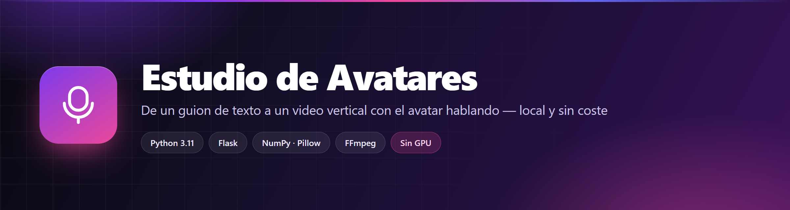
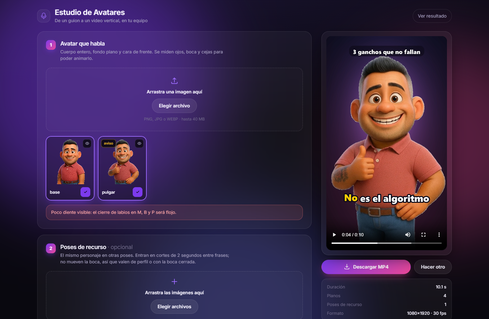
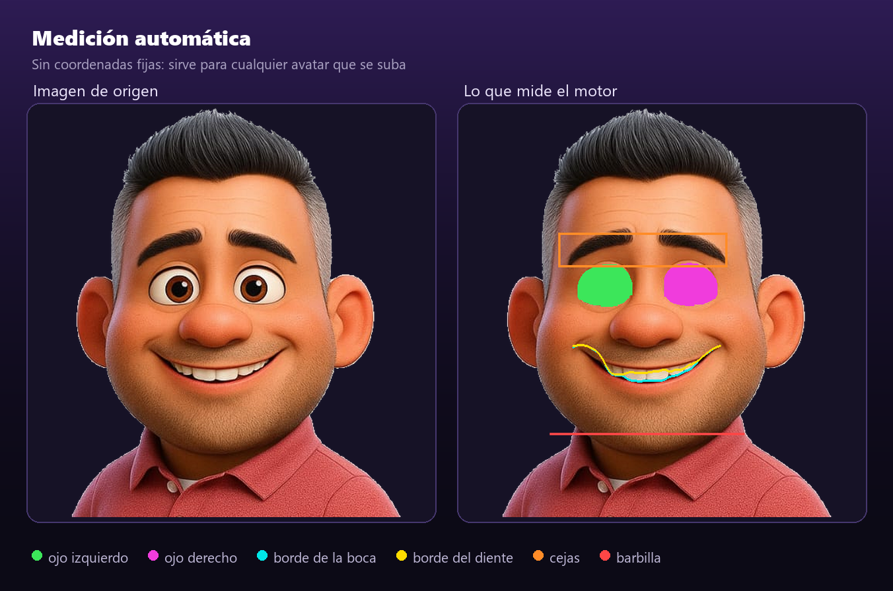
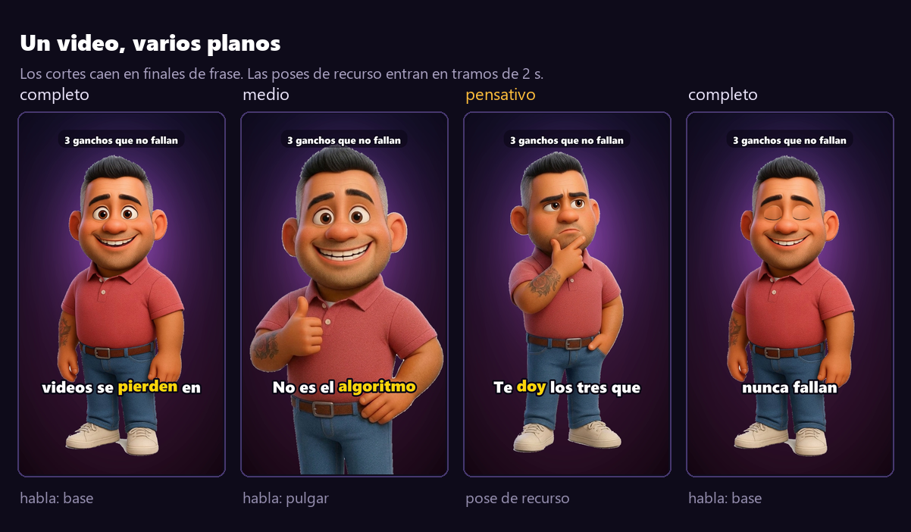

<div align="center">



<br>


**Escribes un guion. Sale un video vertical con tu avatar hablándolo.**
Todo en tu equipo, sin servicios de pago y sin marca de agua.

[Qué hace](#qué-hace) ·
[Pantallas](#pantallas) ·
[Requisitos](#requisitos) ·
[Instalación](#instalación) ·
[El guion](#el-guion) ·
[Arquitectura](#arquitectura) ·
[Antes de tocar el código](#antes-de-tocar-el-código) ·
[Seguridad](#seguridad)

</div>

---

## Qué hace

Empezó como una pregunta concreta: animar **una** imagen de un personaje para que
hablara en TikTok, sin pagar HeyGen ni D-ID, y en un equipo sin GPU útil
(una GT 1030 de 2 GB no mueve SadTalker ni Wav2Lip).

La respuesta fue no usar IA de video. El personaje es una caricatura, y una
caricatura se anima con un **rig de marioneta 2D**: se miden sus rasgos y se
deforman con warps. Eso corre en CPU, es determinista y no deja marca de agua.

| Capacidad | Cómo |
|---|---|
| **Voz en español** | 45 voces neuronales vía `edge-tts`, sin clave ni coste |
| **Labios sincronizados** | El texto → fonemas → visemas. No sigue el volumen del audio |
| **Cierra labios en M, B y P** | Lo que más delata un lip-sync falso; en español salen constantemente |
| **Parpadeo y cejas** | 27 parpadeos/min, colocados en las pausas reales del audio |
| **Cámara con cortes** | Cuatro encuadres que alternan; los cortes caen en finales de frase |
| **Poses de recurso** | El personaje en otras poses, intercalado en tramos de 2 s |
| **Subtítulos karaoke** | Palabra resaltada, agrupados por puntuación |
| **Cualquier avatar** | La medición es automática: no hay coordenadas fijas a un personaje |

El resultado sale en **1080×1920 a 30 fps**, listo para TikTok, Reels o Shorts.
El render tarda alrededor de **un minuto por cada 10 segundos** de video.

---

## Pantallas



La interfaz: subir avatar, elegir voz escuchándola, escribir el guion, ver el
resultado y descargarlo. El aviso naranja es real — ese avatar tiene poco diente
visible y el motor lo detecta y lo dice.

<br>



Esto es lo que hace genérico al motor. Cada imagen que se sube pasa por aquí, y
la imagen de control queda guardada para poder revisarla a ojo.

<br>



> Las capturas salen de la aplicación funcionando con el personaje de ejemplo que
> viene en el repositorio. Ningún dato real de nadie.

---

## Requisitos

| Qué | Versión | Para qué |
|---|---|---|
| Python | 3.11 *(es en lo que está probado)* | Todo el motor |
| FFmpeg | 9.0 | Decodifica el audio y codifica el video |
| RAM | 4 GB bastan | El render es por fotogramas, no carga el video entero |
| GPU | **ninguna** | Todo es NumPy y Pillow en CPU |
| Conexión | solo la primera vez por guion | `edge-tts` pide la voz; luego sale de caché |

> [!IMPORTANT]
> **`edge-tts` tiene que ser 7.x.** El parámetro `boundary="WordBoundary"` no
> existe en la 6.x, y sin él no hay tiempos por palabra: ni visemas, ni cierre de
> labios, ni subtítulos karaoke. Está anotado en [`requirements.txt`](requirements.txt).

FFmpeg no se instala con `pip`. En Windows:

```bash
winget install --id Gyan.FFmpeg -e
```

---

## Instalación

```bash
git clone https://github.com/encrypthdd/animacion-voz-avatar.git
cd animacion-voz-avatar
pip install -r requirements.txt

cd motor
python medir.py      # mide los avatares de avatares/   -> rigs/
python poses.py      # recorta las poses de poses_fuente/ -> poses/
python app.py        # http://127.0.0.1:5000
```

> [!NOTE]
> Los dos comandos del medio **hacen falta en un clon nuevo**: `rigs/` y `poses/`
> son resultados y no se versionan. Tardan unos segundos y solo se repiten si
> cambias las imágenes de origen.

Sin interfaz, por línea de comandos:

```bash
python producir.py            # procesa todos los guiones de guiones/
python producir.py ganchos    # solo ese
python crear.py guiones/x.txt # uno suelto
```

---

## El guion

Un guion es un `.txt` con opciones arriba y el texto debajo:

```
# titulo: 3 ganchos que no fallan
# avatar: base, pulgar
# voz: es-MX-JorgeNeural
# fondo: violeta

Nueve de cada diez videos se pierden en los primeros tres segundos.
No es el algoritmo. Es tu gancho.
```

| Opción | Valores | Por defecto |
|---|---|---|
| `titulo` | Texto fijo arriba del video. Vacío = sin título | *(vacío)* |
| `avatar` | Nombres de `rigs/`. Varios con coma se alternan por plano | `base` |
| `voz` | Cualquier ID de `python -m edge_tts --list-voices` | `es-MX-JorgeNeural` |
| `fondo` | `violeta`, `noche`, `ambar`, `verde`, `carmin` | `violeta` |
| `planos` | `si`, `no`, o un encuadre fijo (`completo`, `medio`, `cerca`) | `si` |
| `recursos` | `si`, `no`, o una lista de poses separadas por comas | `si` |
| `rate` | Velocidad de habla | `+9%` |
| `pitch` | Tono | `-2Hz` |

> [!WARNING]
> **Escribe con tildes y puntuación.** No es cosmético: la voz entona con ellas, y
> los cortes de cámara y de subtítulo salen de los puntos y las comas. Un guion sin
> puntuar se queda en plano fijo y agrupa los subtítulos a lo bruto.

---

## Arquitectura

```
motor/
├── app.py          servidor web (Flask) — envuelve todo lo de abajo
├── web/            la interfaz: HTML, CSS y JS planos, sin dependencias
├── medir.py        imagen → ojos, boca, borde del diente, cejas, barbilla
├── fonemas.py      texto → fonemas → visemas (reglas del español)
├── anim.py         decide la forma de boca de cada fotograma, parpadeos, cejas
├── avatar.py       el rig: mandíbula, ancho de boca, cierre de labios, párpados
├── estilo.py       fondos, encuadres de cámara, tipografía
├── poses.py        recorta y cataloga las poses de recurso
├── render.py       cámara, fondo, subtítulos y codificación
├── crear.py        un guion → un video (voz + envolvente + render)
├── producir.py     por lotes, con incremental
│
├── avatares/       ← imágenes de origen       (se versionan)
├── poses_fuente/   ← imágenes de origen       (se versionan)
├── guiones/        ← tus guiones .txt         (se versionan)
├── rigs/           → lo medido                (no se versiona)
├── poses/          → recortes                 (no se versiona)
└── cache/          → voz reutilizable         (no se versiona)
```

### El recorrido de un guion

1. **`crear.py`** separa la cabecera del texto y calcula una clave con el texto y
   la voz. Si esa clave ya está en `cache/`, no vuelve a pedir el audio.
2. **`edge-tts`** devuelve el MP3 y el tiempo de cada palabra. La puntuación se
   recupera recorriendo el texto original en paralelo, porque llega pelada.
3. **`fonemas.py`** convierte cada palabra en fonemas con reglas del español, y
   cada fonema en tres números: apertura de mandíbula, ancho de boca y cierre de
   labios.
4. **`anim.py`** pone una clave en el centro de cada fonema, interpola, y añade
   parpadeos (en las pausas del audio), acentos de ceja y balanceo.
5. **`render.py`** decide los planos cortando en finales de frase, y para cada
   fotograma pide a **`avatar.py`** el personaje deformado, lo encuadra, pinta el
   fondo y los subtítulos.
6. El fotograma se escribe **crudo a la entrada de FFmpeg**, que lo codifica junto
   al MP3. No se guarda ni un PNG intermedio.

### Endpoints

| Método | Ruta | Qué hace |
|---|---|---|
| `GET` | `/api/inicio` | Voces, fondos, encuadres, avatares y poses disponibles |
| `POST` | `/api/avatar` | Sube una imagen, la mide y devuelve el aviso si lo hay |
| `POST` | `/api/pose` | Sube una pose de recurso y la recorta |
| `GET` | `/api/muestra?voz=` | Muestra de audio de una voz, cacheada |
| `POST` | `/api/generar` | Lanza el render en un hilo, devuelve un id |
| `GET` | `/api/trabajo/<id>` | Estado y porcentaje real de ese render |
| `GET` | `/video/<id>.mp4` | El video, para el reproductor |
| `GET` | `/descargar/<id>` | El mismo video, como descarga |

---

## Antes de tocar el código

Cuatro cosas que costaron horas y no se deducen leyendo los archivos.

<details>
<summary><b>Al hablar le salía una segunda boca debajo</b></summary>

<br>

Muy visible: bajo la cavidad aparecía **otra fila de dientes con su propia línea
oscura**, moviéndose con la mandíbula.

El rig necesita saber dónde acaba el diente superior, porque todo lo que está por
debajo de esa línea baja al abrir. Esa línea estaba aproximada con una parábola de
9 px de curvatura. Al medirla de verdad resultó tener **32 px de arco**: va de
y 367 en las comisuras a y 399 en el centro. La parábola quedaba 3 px por encima en
el centro, así que el filo de los dientes caía dentro de la banda móvil y bajaba
con ella.

Ahora el borde se **mide columna por columna** y se guarda en el `.npz`. Está en
`medir.py`, función `detectar_boca()`.

</details>

<details>
<summary><b>El festón de los dientes y la curva de la sonrisa se confunden</b></summary>

<br>

Los dientes tienen filo festoneado (0.7 px de media, hasta 4.2) y hay que
rebajarlo para que la cavidad no salga dentada. Lo obvio es una envolvente: tomar
el máximo en una ventana de columnas.

No funciona. La curva de la sonrisa tiene pendientes de **1.7 px por columna**, así
que una ventana de ±5 captura 8.6 px de pendiente además del festón, y arrastra la
línea hasta 13 px. El síntoma son esquirlas de labio claro flotando sobre la
cavidad oscura.

La solución es separar **tendencia** de **residuo** y aplicar la envolvente solo al
residuo. El desplazamiento baja de 2.47 px a 1.05 px, que es el festón real.
`medir.py`, función `_envolvente()`.

</details>

<details>
<summary><b>El medidor detectaba las cejas como si fueran los ojos</b></summary>

<br>

Todo salía desplazado unos 55 px hacia arriba, y con ello la ventana de búsqueda de
la boca, que acababa en la barbilla.

El motivo es razonable: una ceja **también** es una isla oscura rodeada de piel,
viene en pareja y está a la misma altura que su gemela. Y la puntuación premiaba
estar arriba.

Buscar la esclerótica tampoco sirve, porque el iris la parte en dos medialunas
finas que cualquier filtro de forma descarta. Lo que funciona es buscar la
**abertura entera del ojo** como región no-piel, y exigir que contenga esclerótica:
un ojo tiene píxeles claros dentro, una ceja no. `medir.py`, función
`detectar_ojos()`.

</details>

<details>
<summary><b>En Windows, un video correcto se marcaba como fallido</b></summary>

<br>

La interfaz decía «error» y el MP4 estaba perfecto, con su duración completa.

Los fotogramas se escriben a la entrada de FFmpeg, que corre con `-shortest`: al
agotarse el audio cierra la entrada mientras el motor aún escribe los últimos
fotogramas de cola. Eso es normal y se ignora a propósito.

El problema es que en Windows ese cierre **no siempre llega como
`BrokenPipeError`**: puede salir como `OSError` con `errno 22`. Capturar solo el
primero dejaba escapar el segundo.

Ahora quien decide el éxito es el **código de salida de FFmpeg**, no la excepción, y
además se comprueba que el archivo no haya quedado vacío. `render.py`, método
`Video.encode()`.

</details>

---

## Seguridad

Es una herramienta local, no un servicio. Esto es lo que hace el servidor,
comprobado en `app.py`:

- **Solo escucha en `127.0.0.1`** y con `debug=False`, así que no queda expuesta a
  la red ni abre la consola de depuración de Flask.
- **Las subidas están limitadas a 40 MB** (`MAX_CONTENT_LENGTH`) y a extensiones
  `.png`, `.jpg`, `.jpeg` y `.webp`.
- **Los nombres de archivo se sanean**: se quitan los acentos y todo lo que no sea
  letra, número, guion o guion bajo, así que una subida no puede escribir fuera de
  su carpeta.
- **La ruta `/media/` comprueba que el destino quede dentro del proyecto** antes de
  servir nada.
- **El identificador de voz se valida** contra la lista real antes de llamar a
  `edge-tts`.

No hay autenticación ni cifrado, porque no hay nada que atender fuera de tu equipo.
**Si la publicas en una red, eso cambia por completo** y habría que añadirlos.

---

## Documentación

| Dónde | Qué hay |
|---|---|
| [`motor/LEEME.md`](motor/LEEME.md) | El manual: cada opción, cómo ajustar el rig, los visemas, la cámara y las trampas de medición al completo |
| `rigs/<nombre>_check.png` | La medición de cada avatar, para revisarla a ojo |

---

## Contribuidores

<table>
<tr>
<td align="center" width="260">
<a href="https://github.com/encrypthdd">
<br>
<b>Carlos Flores</b>
</a><br>
<sub>@encrypthdd</sub><br>
<sub><i>Idea, personaje y dirección</i></sub>
</td>
</tr>
</table>

---

<div align="center">

<sub>Hecho para publicar en vertical sin depender de nadie.</sub>

<sub>Las voces son de Microsoft Edge vía <a href="https://github.com/rany2/edge-tts">edge-tts</a> · El video lo arma <a href="https://ffmpeg.org">FFmpeg</a></sub>

</div>
